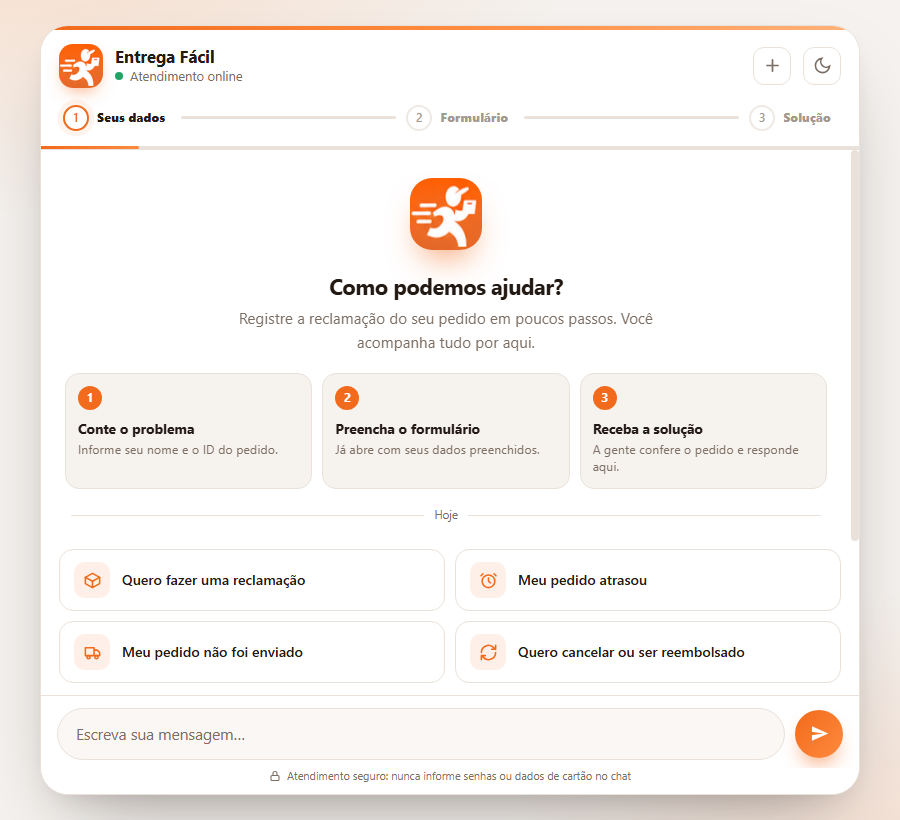
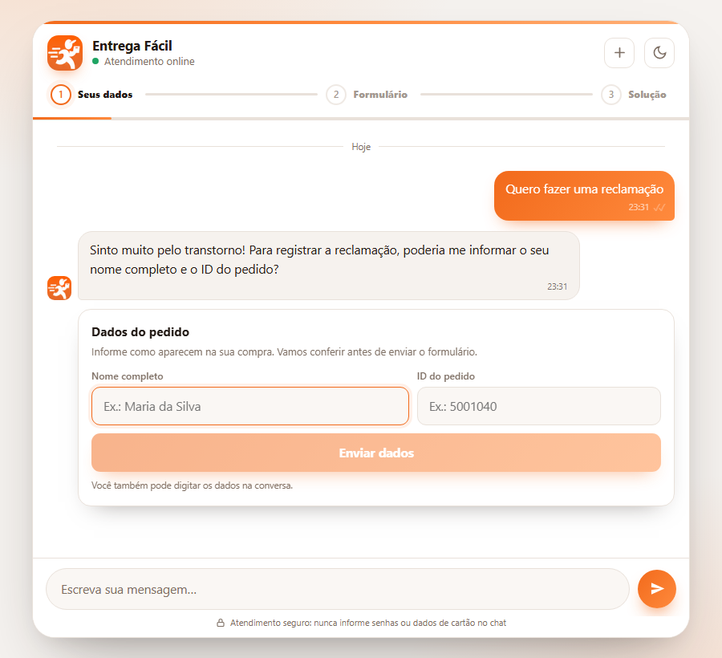
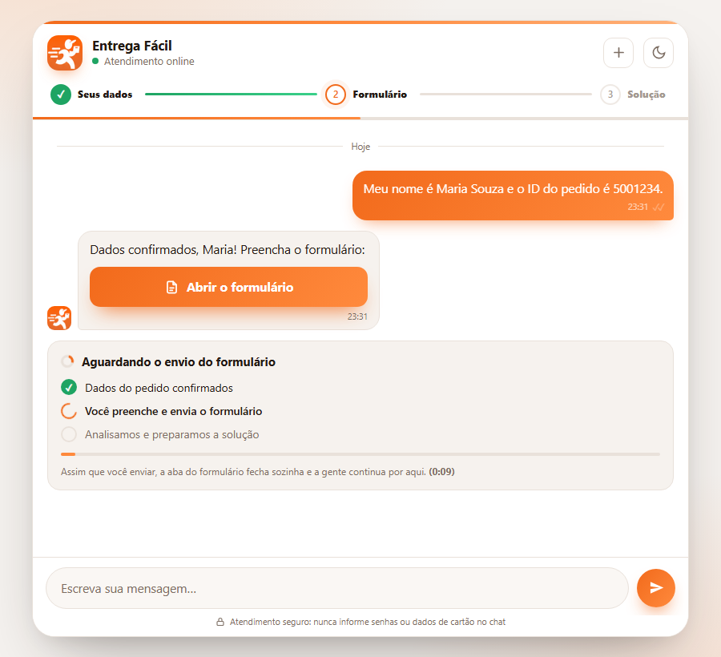
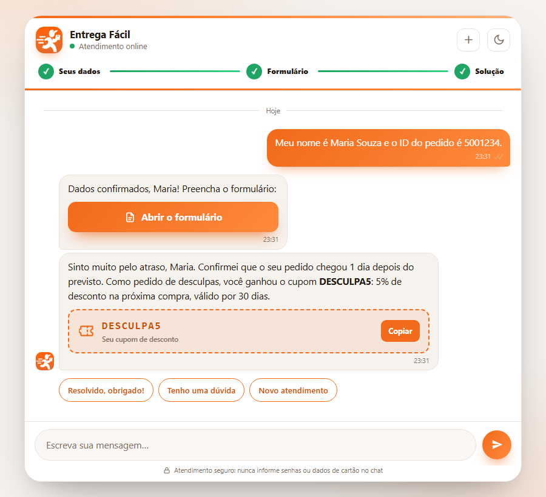
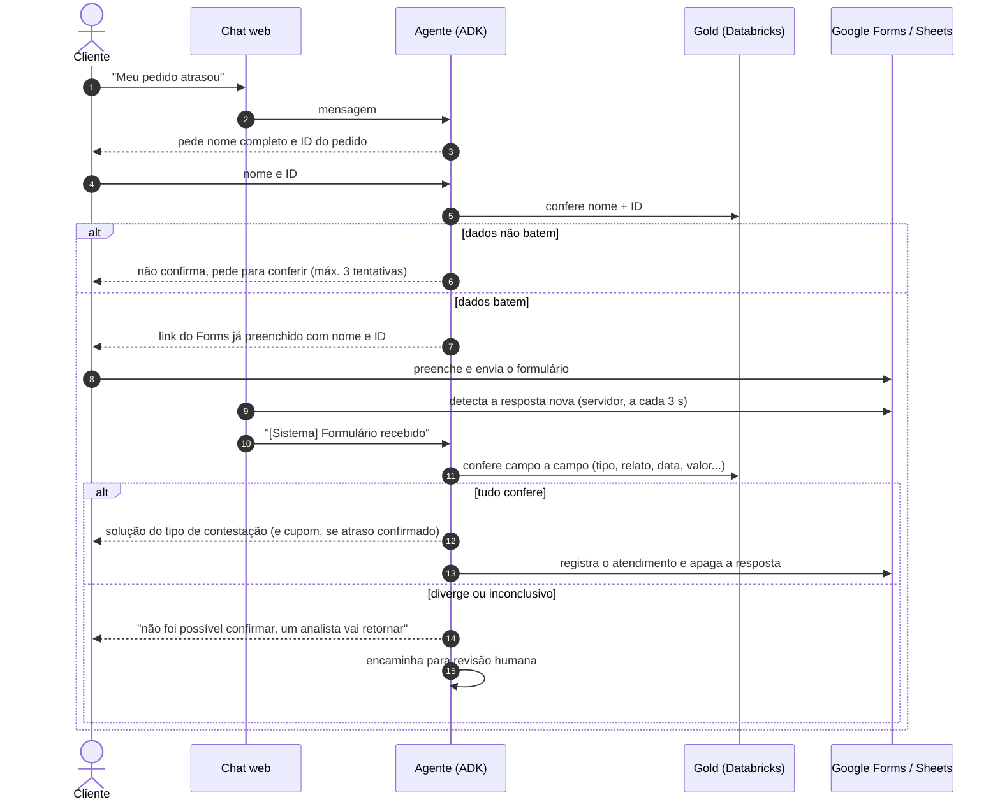

<div align="center">


# Entrega Fácil

**Agente de IA para atendimento de reclamações de pedidos, com resposta confirmada na tabela Gold.**

O cliente conta o problema no chat, preenche um formulário e recebe a solução certa para o tipo de contestação, somente se o que ele disse bater com os dados reais do pedido.

</div>

---

## Sumário

- [O que é](#o-que-é)
- [Interface](#interface)
- [Como funciona](#como-funciona)
- [Conferência com a tabela Gold](#conferência-com-a-tabela-gold)
- [Tipos de contestação](#tipos-de-contestação)
- [Política de cupons por atraso](#política-de-cupons-por-atraso)
- [Segurança e privacidade](#segurança-e-privacidade)
- [Arquitetura](#arquitetura)
- [Estrutura do repositório](#estrutura-do-repositório)
- [Como rodar](#como-rodar)
- [Configuração](#configuração)
- [Testes](#testes)
- [Desempenho](#desempenho)
- [Documentação](#documentação)
- [Limitações conhecidas](#limitações-conhecidas)

---

## O que é

A **Entrega Fácil** é um assistente de atendimento construído com o [Google ADK](https://google.github.io/adk-docs/) (Agent Development Kit) e modelos Gemini, com reservas automáticas para outros modelos. Ele conversa com o cliente em português, recebe a reclamação por um **Google Forms** e responde com a solução do tipo de contestação, sempre confrontando o que o cliente disse com a **tabela Gold** de pedidos no Databricks.

Princípios do projeto:

- **A Gold é a fonte da verdade.** O modelo nunca inventa status, datas, prazos, valores ou cupons. Tudo vem de ferramentas que consultam a base.
- **Nome e ID certos não bastam.** Se o tipo de contestação ou o relato não batem com o que a Gold registra, o agente não entrega solução nenhuma e encaminha o caso para um analista.
- **O backend decide, o modelo escreve.** Classificação, conferência, faixa de cupom e registro são regras determinísticas em código. O modelo só redige a mensagem ao cliente.
- **Nada fica guardado à toa.** A resposta do Forms é apagada da planilha quando o atendimento é concluído.

## Interface

O cliente atende tudo pelo navegador, sem instalar nada. As imagens abaixo usam dados fictícios.

<table>
  <tr>
    <td width="50%"><br><sub><b>1. Início:</b> atalhos e o passo a passo do atendimento.</sub></td>
    <td width="50%"><br><sub><b>2. Seus dados:</b> nome e ID do pedido em um cartão, conferidos antes de enviar o formulário.</sub></td>
  </tr>
  <tr>
    <td width="50%"><br><sub><b>3. Formulário:</b> abre já preenchido; o chat acompanha o envio e fecha a aba sozinho.</sub></td>
    <td width="50%"><br><sub><b>4. Solução:</b> resposta conferida com a Gold, cupom com botão de copiar e respostas rápidas.</sub></td>
  </tr>
</table>

Os passos do topo são clicáveis: ao passar o mouse mostram o que cada etapa faz e, ao clicar, levam o cliente de volta ao ponto certo. Há tema claro e escuro, e o layout se adapta ao celular.

## Como funciona



1. **Triagem no chat.** O agente identifica o problema, pede **nome completo e ID do pedido** e só envia o link do formulário se os dois baterem com a Gold. O link já abre com os campos preenchidos (o cliente pode corrigi-los).
2. **Detecção automática.** O servidor do chat confere a planilha de respostas e, ao chegar uma reclamação nova, aciona o agente. O cliente não precisa avisar que terminou.
3. **Conferência.** Cada campo do Forms é comparado com a Gold (veja a tabela abaixo).
4. **Resposta.** Se tudo confere, o agente responde pelo script do tipo de contestação. Caso contrário, encaminha para um analista sem revelar dados do pedido.
5. **Encerramento.** O atendimento é registrado (sem relato nem contato do cliente) e a resposta do Forms é apagada da planilha.

## Conferência com a tabela Gold

A conferência é feita por [tools/verificacao.py](tools/verificacao.py), campo a campo. Palavras diferentes com o mesmo sentido são aceitas.

| Campo do Forms | Comparado com (Gold) | Tolerância |
|---|---|---|
| Nome | `nome_cliente` | Ignora acento, caixa, ordem, "de/da/dos", nome do meio e erro de digitação. Nome incompleto de uma só palavra não vale para nome composto. |
| ID do pedido | `id_pedido` | Aceita zeros à esquerda. |
| Data da compra | `data_pedido` | ±1 dia (fuso). |
| Tipo de contestação | `motivos_reclamacao`, `situacao_pedido`, datas de entrega, `qtd_itens` × `qtd_enviada` | O tipo precisa ser compatível com o que a Gold registra. |
| Relato | tipo de contestação | Aceita sinônimos e erros de digitação ("atrazou", "demorou", "passou do prazo"). Um assunto diferente diverge. |
| Relato | produto do pedido | Informativo: confere se o relato cita o produto. |
| Valor | `valor_pedido` | 1% de tolerância, se a Gold tiver a coluna. |
| E-mail de contato | e-mail do cadastro | Não bloqueia (pode ser outro e-mail de contato). |

**Resultados possíveis:** `confere` (segue o atendimento), `diverge` (a Gold contradiz o cliente) e `inconclusivo` (a Gold não tem dado para decidir). Nos dois últimos o agente **não dá solução**, não oferece cupom e encaminha para revisão humana. `registrar_atendimento` recusa registrar sem um `confere`, mesmo que o modelo tente.

## Tipos de contestação

Definidos em [tools/tipos_reclamacao.py](tools/tipos_reclamacao.py) e descritos em [knowledge_base/scripts_por_tipo_reclamacao.md](knowledge_base/scripts_por_tipo_reclamacao.md). A classificação nunca é feita pelo modelo.

| Tipo | Equipe | O que o agente faz | Cupom |
|---|---|---|---|
| Atraso na entrega | Atendimento | Pede desculpas e apresenta o cupom da faixa, se o atraso foi confirmado pelas datas da Gold | Sim, só com atraso confirmado |
| Pedido não enviado | Logística | Informa que a solicitação foi para análise do setor | Não |
| Item faltando | Logística | Informa que a equipe vai passar as etapas de devolução | Não |
| Cancelamento ou reembolso | Financeiro | Não valida por conta própria e encaminha ao Financeiro | Não |
| Cobrança diferente | Financeiro | Igual ao anterior; a Gold não tem valores pagos | Não |
| Produto errado | Trocas e Devoluções | Pede foto do produto e da etiqueta e pergunta se prefere troca ou reembolso | Não |
| Pedido não encontrado | Atendimento | Aciona um analista, sem pedir os dados de novo | Não |
| Não reconhecido | Revisão humana | Encaminha para um analista | Não |

## Política de cupons por atraso

O código e a faixa são calculados pela ferramenta `oferecer_cupom_atraso` a partir dos dias de atraso confirmados pela Gold. O modelo nunca escolhe o cupom.

| Atraso | Compensação | Código | Validade |
|---|---|---|---|
| 1 dia | Frete grátis | `EF-FRETE` | 30 dias |
| 2 dias | 5% de desconto | `EF-CORTESIA5` | 30 dias |
| 3 a 4 dias | 10% de desconto | `EF-GARANTIA10` | 30 dias |
| 5 a 7 dias | 15% de desconto | `EF-COMPROMISSO15` | 45 dias |
| 8 a 14 dias | 20% + prioridade no atendimento e no envio | `EF-PRIORIDADE20` | 45 dias |
| 15 dias ou mais | 25% (ou cancelamento com reembolso, via revisão humana) | `EF-PREMIUM25` | 60 dias |

Cada faixa tem um modelo de resposta próprio, devolvido pela ferramenta junto com o cupom. Cliente muito irritado com atraso de 1 ou 2 dias pode subir para a faixa de 10%. A regra completa está em [knowledge_base/politica_cupons_atraso.md](knowledge_base/politica_cupons_atraso.md).

## Segurança e privacidade

- **Relatos são dados não confiáveis.** Há detecção de *prompt injection* no relato, no tipo de contestação e nos campos textuais da Gold. Casos suspeitos são retidos para revisão humana.
- **Mascaramento.** CPF, cartão, nome e ID do pedido são removidos do que o modelo recebe. O modelo só vê o primeiro nome do cliente.
- **Sem pistas.** Quando nome e ID não batem, o agente não diz qual dos dois está errado nem o que consta na base. Depois de 3 tentativas, o link não é mais enviado.
- **Mensagens `[Sistema]`.** Texto do cliente que imite mensagens internas é recusado pelo servidor do chat.
- **Registro mínimo.** O arquivo de atendimentos guarda só metadados (ID, tipo, status, cupom, resultado), sem relato, nome ou contato.
- **Exclusão.** A linha da resposta no Forms é apagada ao concluir o atendimento (revisão humana mantém a linha para o analista).
- **Segredos fora do código.** Chaves e tokens ficam no `.env` e em `service_account*.json`, ambos no `.gitignore`.

## Arquitetura

```text
Cliente ── Chat web (FastAPI + HTML) ──┐
                                       ├── Agente ADK (Gemini)
adk web (desenvolvimento) ─────────────┘        │
                                                ├── tools/ ........ ferramentas e regras
                                                ├── integrations/ . Forms/Sheets, Databricks, proteção de dados
                                                └── retriever/ .... busca BM25 na base de conhecimento
```

- **Modelos:** só Gemini (Google), em cadeia de roteamento definida por `GEMINI_MODELOS`. Se o modelo principal passa de `MODELO_HEDGE_SEGUNDOS` (3 s) sem responder, o próximo entra em paralelo e vale a primeira resposta; cada modelo é chamado até duas vezes e, em qualquer erro, o agente passa para o próximo; se todos falharem, a cadeia recomeça até algum responder. Se todos falharem, o cliente recebe uma mensagem segura e o caso vai para revisão humana.
- **Chat web:** servidor FastAPI que entrega só o texto escrito ao cliente (as chamadas de ferramenta ficam no servidor), com indicador de "digitando", passos do atendimento, botão do formulário e cartão de cupom.
- **Espera do formulário no servidor:** o agente envia o link e encerra a resposta; o servidor confere a planilha e aciona o agente quando o formulário chega. Assim o link aparece na hora.
- **Cache de curta duração:** a planilha do Forms (20 s) e a consulta à Gold (60 s) são reaproveitadas entre as ferramentas de um mesmo atendimento.

## Estrutura do repositório

```text
.
├── agente_triagem/        # Agente ADK: instruções, modelos, ferramentas e busca lexical
├── chat_web/              # Chat para o cliente (FastAPI + página HTML)
├── tools/                 # Ferramentas do agente e regras de negócio
│   ├── consultar_dados.py     # fila, pedido na Gold e confirmação de identidade
│   ├── verificacao.py         # conferência Forms x Gold, campo a campo
│   ├── tipos_reclamacao.py    # tipos de contestação, equipes e ações
│   ├── politica_cupons.py     # faixas de cupom por atraso
│   ├── formulario.py          # link do Forms e detecção de envio
│   └── salvar_atendimento.py  # registro, revisão humana e exclusão da resposta
├── integrations/          # Forms/Sheets, Databricks, latência, proteção de dados
├── retriever/             # Busca BM25 com correção de digitação
├── knowledge_base/        # Scripts por tipo, política de cupons, regras de atendimento
├── eval/                  # Avaliação local com casos sintéticos
├── docs/                  # Contratos de dados, dashboard de latência, Apps Scripts
├── scripts/               # Utilitários (teste da conexão com o Databricks)
└── data/saida/            # Registro local de atendimentos (ignorado pelo git)
```

## Como rodar

### Pré-requisitos

- Python 3.11 ou superior
- Chave da API do Gemini (Google AI Studio)
- Acesso de leitura à tabela Gold no Databricks
- Um Google Forms público e a planilha de respostas dele

### Instalação

```bash
git clone https://github.com/NathaliaRJ03/entrega-facil-agent.git
cd entrega-facil-agent

python -m venv .venv
# Windows: .venv\Scripts\activate    |    Linux/macOS: source .venv/bin/activate

pip install -r requirements.txt
cp .env.example .env        # Windows: copy .env.example .env
```

Preencha o `.env` (veja [Configuração](#configuração)).

### Chat web (experiência do cliente)

```bash
python -m uvicorn chat_web.app:app --port 8080
```

Abra <http://localhost:8080>.

### Interface de desenvolvimento do ADK

```bash
adk web
```

Útil para depurar as chamadas de ferramenta. Ela mostra as ferramentas, então não é a interface recomendada para o cliente.

### Testar a conexão com a Gold

```bash
python scripts/testar_databricks.py <ID_DO_PEDIDO>
```

## Configuração

Todas as variáveis ficam no `.env` (modelo em [.env.example](.env.example)).

| Variável | Para que serve |
|---|---|
| `GOOGLE_API_KEY` | Chave do Gemini |
| `GEMINI_MODELOS` | Modelos Gemini separados por vírgula, do principal às reservas (padrão `gemini-3.5-flash-lite,gemini-3.1-flash-lite,gemini-3.6-flash`) |
| `MODELO_HEDGE_SEGUNDOS` | Tempo até a reserva entrar em paralelo (`0` desliga) |
| `MODELO_INSISTENCIA_SEGUNDOS` | Se todos os modelos falharem, a cadeia recomeça até algum responder, por no máximo este tempo (`0` = sem limite; padrão 300) |
| `FORMS_URL` | Link público do Google Forms enviado ao cliente |
| `FORMS_CSV_URL` | Leitura da planilha de respostas (CSV exportado, em tempo real) |
| `FORMS_SHEET_ID`, `FORMS_SHEET_ABA` | Planilha de respostas, para ler e apagar linhas via API |
| `GOOGLE_SERVICE_ACCOUNT_FILE` | Credencial da conta de serviço (precisa ser **Editora** da planilha para apagar respostas) |
| `FORMS_ENTRY_NOME`, `FORMS_ENTRY_PEDIDO` | Códigos das perguntas do Forms, para o link pré-preenchido (opcionais, já há padrão) |
| `FORMS_ESPERA_SEGUNDOS`, `FORMS_INTERVALO_SEGUNDOS` | Tempo máximo de espera pelo envio do formulário e intervalo de conferência |
| `DATABRICKS_SERVER_HOSTNAME`, `DATABRICKS_HTTP_PATH`, `DATABRICKS_TOKEN` | Conexão com o Databricks |
| `DATABRICKS_TABELA_GOLD_PEDIDOS` | Tabela Gold de pedidos (`catalogo.schema.tabela`) |
| `LATENCIA_SHEETS_ID`, `LATENCIA_SHEETS_ABA`, `TICKETS_SHEETS_ABA` | Planilha de métricas (latência e tickets) |
| `SHEETS_WEBHOOK_URL`, `SHEETS_WEBHOOK_TOKEN` | Alternativa por Apps Script à conta de serviço |

### Colunas esperadas

- **Forms:** Nome, E-mail de contato, ID do pedido, Tipo de contestação, Descreva o que ocorreu, Informe quando a compra foi realizada.
- **Gold:** `id_pedido`, `nome_cliente`, `situacao_pedido`, `data_pedido`, `data_planejada_entrega`, `data_real_entrega`, `atraso_status`, `descricao_produto`, `motivos_reclamacao`, `qtd_itens`, `qtd_enviada` e, opcionalmente, `valor_pedido`. Cabeçalhos alternativos são aceitos e estão em [docs/CONTRATOS_DE_DADOS.md](docs/CONTRATOS_DE_DADOS.md).

## Testes

A avaliação é local, usa dados sintéticos e **não chama o modelo nem a Gold**:

```bash
python eval/rodar_eval.py
```

Ela cobre fila e privacidade, regras de cupom, registro minimizado, conferência Forms × Gold (tipo errado, relato de outro assunto, sinônimos, data e valor), confirmação de identidade antes do link, medição de latência, tickets, busca BM25 e o *failover* entre modelos.

## Desempenho

- Resposta curta ("oi"): cerca de 1,5 s.
- O fluxo de atendimento foi otimizado para poucas idas ao modelo: o ID da reclamação vem direto da detecção do envio, o pedido e a reclamação são consultados em paralelo e o script do tipo já vem junto dos dados.
- A latência de cada invocação do agente é medida e enviada ao Google Sheets em segundo plano. Veja [docs/LATENCIA_DASHBOARD.md](docs/LATENCIA_DASHBOARD.md).

## Documentação

| Documento | Conteúdo |
|---|---|
| [docs/CONTRATOS_DE_DADOS.md](docs/CONTRATOS_DE_DADOS.md) | Colunas esperadas do Forms e da Gold, e como o agente usa cada uma |
| [docs/LATENCIA_DASHBOARD.md](docs/LATENCIA_DASHBOARD.md) | Métricas de latência e tickets no Google Sheets |
| [docs/apps_script_confirmacao_forms.gs](docs/apps_script_confirmacao_forms.gs) | Apps Script que envia e-mail de confirmação ao receber o Forms |
| [docs/apps_script_sheets.gs](docs/apps_script_sheets.gs) | Webhook em Apps Script para gravar métricas sem conta de serviço |
| [knowledge_base/](knowledge_base/) | Scripts por tipo de contestação, política de cupons e regras de atendimento |

## Limitações conhecidas

- O agente atende a **reclamação pendente mais recente**. Dois clientes enviando o formulário quase ao mesmo tempo podem ser trocados; cruzar o e-mail do cliente com o do Forms resolveria.
- A conferência do relato usa **lista de palavras e sinônimos**, não leitura de sentido. Relatos legítimos com vocabulário muito diferente podem ir para revisão humana (o lado seguro do erro).
- O vocabulário de status da Gold (como "Concluído", "Em aberto", "Parcialmente processado") foi mapeado a partir dos dados atuais. Novos status caem em "inconclusivo" até serem mapeados.
- As sessões do chat ficam em memória: reiniciar o servidor encerra as conversas em andamento.
- Apagar a resposta do Forms exige que a conta de serviço seja editora da planilha.
